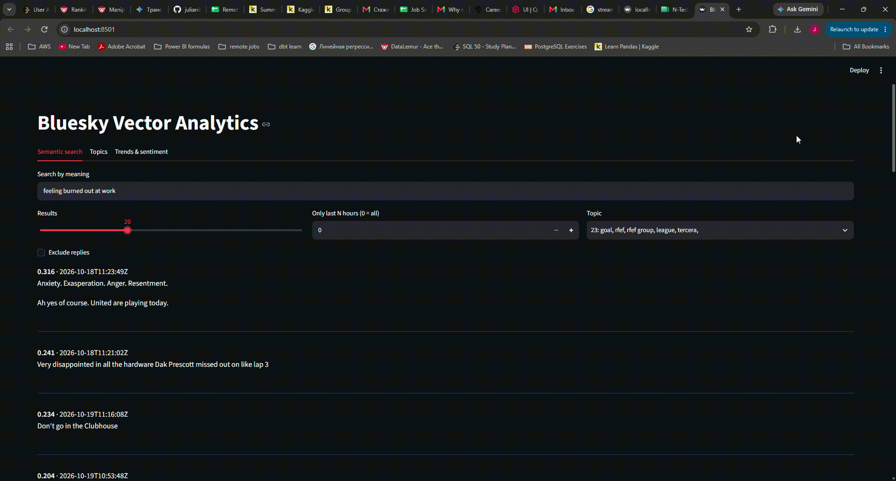
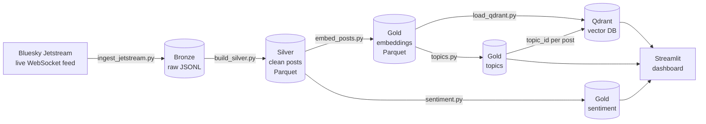

# Bluesky Vector Analytics

A data pipeline that collects live posts from the Bluesky social network, cleans them into a layered Parquet data lake, turns each post into a vector embedding, and stores the vectors in Qdrant. A Streamlit dashboard on top offers **semantic search**, **topic discovery**, **sentiment by topic** and **trending topics**.

Everything runs locally on a laptop with free, open-source tools. No cloud account or API key is needed.



---

## Contents

- [Features](#features)
- [Architecture](#architecture)
- [Tech stack](#tech-stack)
- [Project structure](#project-structure)
- [Getting started](#getting-started)
- [Running the pipeline](#running-the-pipeline)
- [Using the dashboard](#using-the-dashboard)
- [Configuration](#configuration)
- [Design decisions](#design-decisions)
- [Results](#results)
- [Limitations and next steps](#limitations-and-next-steps)
- [Data and privacy](#data-and-privacy)

---


## Features


| Feature                 | Question it answers                                              | How                                                                                         |
| ----------------------- | ---------------------------------------------------------------- | ------------------------------------------------------------------------------------------- |
| **Semantic search**     | "Show me posts *about* burnout, even if they never use the word" | Query embedding + Qdrant nearest-neighbour search, with filters for time, topic and replies |
| **Topic discovery**     | "What are people talking about?" (no predefined categories)      | UMAP + HDBSCAN clustering on the embeddings, TF-IDF keywords per topic                      |
| **Sentiment by topic**  | "How do people feel about each topic?"                           | Pre-trained RoBERTa sentiment model on a sample of posts                                    |
| **Trending topics**     | "Which topics are growing right now?"                            | Each topic's share of recent posts compared with its earlier share                          |
| **Duplicate detection** | "Is there copy-paste spam or coordinated posting?"               | Exact text hashes (SQL) and near-duplicate vectors (Qdrant)                                 |


---


## Architecture




The data moves through three layers (the **medallion** pattern):


| Layer      | Location                                          | Contents                                                                                                 |
| ---------- | ------------------------------------------------- | -------------------------------------------------------------------------------------------------------- |
| **Bronze** | `data/bronze/date=YYYY-MM-DD/hour=HH/posts.jsonl` | Every raw message exactly as received. Never modified, so every later layer can be rebuilt from it.      |
| **Silver** | `data/silver/posts.parquet`                       | One clean row per English post: duplicates and deleted posts removed, links stripped, hashtags extracted |
| **Gold**   | `data/gold/`                                      | Analysis outputs: embeddings, topics, post-to-topic mapping, sentiment                                   |


**Qdrant** is the *serving layer*: it holds a copy of the vectors plus metadata (text, time, reply flag, topic) for fast search. The Parquet files remain the source of truth.

---


## Tech stack


| Component       | Tool                                                                                                                                              | Why                                                                     |
| --------------- | ------------------------------------------------------------------------------------------------------------------------------------------------- | ----------------------------------------------------------------------- |
| Language        | Python 3.12                                                                                                                                       | Supported by all the ML libraries used here                             |
| Data source     | [Bluesky Jetstream](https://github.com/bluesky-social/jetstream) via `websockets`                                                                 | Free, public, real-time JSON feed with no authentication                |
| Transformations | DuckDB                                                                                                                                            | Runs SQL directly on JSON and Parquet files, with no database server    |
| Storage         | Parquet (`pyarrow`)                                                                                                                               | Columnar, compressed and typed: the standard data lake format           |
| Embeddings      | `sentence-transformers` with `[all-MiniLM-L6-v2](https://huggingface.co/sentence-transformers/all-MiniLM-L6-v2)` (384 dimensions)                 | Small and fast on a CPU, good general-purpose quality                   |
| Vector database | [Qdrant](https://qdrant.tech/) `v1.20.0` in Docker                                                                                                | Open source, runs locally, combines vector search with metadata filters |
| Topic modelling | `umap-learn`, `scikit-learn` (HDBSCAN, TF-IDF)                                                                                                    | Finds the number of topics itself and labels unrelated posts as noise   |
| Sentiment       | `transformers` with `[cardiffnlp/twitter-roberta-base-sentiment-latest](https://huggingface.co/cardiffnlp/twitter-roberta-base-sentiment-latest)` | Trained on ~124M tweets, a close match to short social posts            |
| Orchestration   | Prefect                                                                                                                                           | Runs the pipeline steps in order, with retries, logs and a web UI       |
| Dashboard       | Streamlit                                                                                                                                         | Interactive web app written in plain Python                             |


All direct dependencies are listed in `[requirements.txt](requirements.txt)`. Exact pinned versions for a reproducible install are in `[requirements.lock.txt](requirements.lock.txt)`.

---


## Project structure

```
bluesky-vector-analytics/
├── app.py                   # Streamlit dashboard
├── pipeline.py              # Prefect flow: runs the pipeline steps in order
├── docker-compose.yml       # Qdrant service (pinned version, persistent volume)
├── requirements.txt         # direct dependencies
├── requirements.lock.txt    # exact versions of every installed package
├── notes-findings.md        # analysis notes and experiment log
├── docs/
│   └── Analytics_demo.gif   # dashboard demo
├── src/
│   ├── config.py            # all paths, model names and URLs in one place
│   ├── ingest_jetstream.py  # live feed → bronze
│   ├── build_silver.py      # bronze → silver (DuckDB SQL)
│   ├── embed_posts.py       # silver → embeddings (incremental)
│   ├── load_qdrant.py       # embeddings → Qdrant (idempotent upsert)
│   ├── topics.py            # topic discovery; writes topic_id to Qdrant
│   ├── sentiment.py         # sentiment on a sample of posts
│   ├── trends.py            # fastest-growing topics
│   ├── duplicates.py        # exact and near-duplicate detection
│   └── search.py            # semantic search function + CLI
└── data/                    # bronze / silver / gold (git-ignored, created at runtime)
```

---


## Getting started


### Prerequisites

- **Python 3.12**
- **Docker Desktop** (runs Qdrant)
- **Git**
- An internet connection: the first run downloads the embedding model (~90 MB) and the sentiment model (~500 MB) from Hugging Face. They're cached after that.

The commands below are for Windows PowerShell. On macOS or Linux, activate the environment with `source .venv/bin/activate`. Everything else is the same.

### Installation

```powershell
# 1. Clone the repository
git clone https://github.com/julianikitina-14/bluesky-vector-analytics.git
cd bluesky-vector-analytics

# 2. Create and activate a virtual environment
python -m venv .venv
.\.venv\Scripts\Activate.ps1

# 3. Install the exact dependency versions
pip install -r requirements.lock.txt

# 4. Start Qdrant (Docker Desktop must be running)
docker compose up -d
```

Check that Qdrant is up with `docker compose ps`, or open its dashboard at [http://localhost:6333/dashboard](http://localhost:6333/dashboard).

---


## Running the pipeline

Run all commands from the project root with the virtual environment active.

### Option A: step by step


| #   | Command                                       | What it does                                                    | Reads → Writes                                                         |
| --- | --------------------------------------------- | --------------------------------------------------------------- | ---------------------------------------------------------------------- |
| 1   | `python -m src.ingest_jetstream --minutes 60` | Collects live posts for N minutes (default 10)                  | Jetstream → `data/bronze/`                                             |
| 2   | `python -m src.build_silver`                  | Deduplicates, applies deletes, keeps English posts, cleans text | bronze → `data/silver/posts.parquet`                                   |
| 3   | `python -m src.embed_posts`                   | Embeds posts that don't have a vector yet                       | silver → `data/gold/embeddings/`                                       |
| 4   | `python -m src.load_qdrant`                   | Uploads vectors and metadata                                    | embeddings → Qdrant                                                    |
| 5   | `python -m src.topics --min-cluster-size 100` | Discovers topics and tags every post in Qdrant                  | embeddings → `data/gold/topics.parquet`, `post_topics.parquet`, Qdrant |
| 6   | `python -m src.sentiment`                     | Scores sentiment on a random sample (default 2,000 posts)       | silver + topics → `data/gold/sentiment.parquet`                        |


Steps 1–5 must run in order. Step 6 needs step 5.

Analyses that print results to the terminal (no files written):

```powershell
python -m src.search "feeling burned out at work"   # semantic search (needs Qdrant)
python -m src.trends --recent-hours 3                # fastest-growing topics
python -m src.duplicates                             # copy-paste detection (needs Qdrant)
```


### Option B: one command with Prefect

`pipeline.py` runs steps 1–5 as a single Prefect flow. Each step is a task, the flow stops if a step fails, and the network-dependent steps (collect, load) retry automatically.

```powershell
python pipeline.py
```

Parameters (defaults in brackets): `collect_minutes` (5), `min_cluster_size` (100), `run_topics` (True). For example, a quick run without re-clustering:

```powershell
python -c "from pipeline import bluesky_pipeline; bluesky_pipeline(collect_minutes=1, run_topics=False)"
```

To browse runs, logs and timings in the Prefect UI, start the server in a second terminal and point Prefect at it:

```powershell
prefect server start                                          # terminal 2: UI at http://127.0.0.1:4200
prefect config set PREFECT_API_URL=http://127.0.0.1:4200/api  # terminal 1, once
```

Sentiment is not part of the flow: it's slow on a CPU and works on a sample, so run it by hand when needed.

### Runtimes (4-core laptop, CPU only)


| Step                   | Time                   |
| ---------------------- | ---------------------- |
| Topics, ~43k posts     | 3–6 min                |
| Sentiment, 2,000 posts | ~10 min (~3.4 posts/s) |


---


## Using the dashboard

```powershell
streamlit run app.py
```

Opens at [http://localhost:8501](http://localhost:8501). Qdrant must be running for the search tab.


| Tab                    | What you can do                                                                                                                                                                            |
| ---------------------- | ------------------------------------------------------------------------------------------------------------------------------------------------------------------------------------------ |
| **Semantic search**    | Type a query in plain language. Optionally narrow the results by topic, time window or "exclude replies". The search ranks by meaning, so a query is required; the filters narrow it down. |
| **Topics**             | See the 25 largest topics, then pick any topic to see its keywords, size and three representative posts                                                                                    |
| **Trends & sentiment** | Fastest-growing topics for an adjustable time window, and the share of negative / neutral / positive posts per topic (most negative first)                                                 |


**Stopping everything:** `Ctrl+C` in the Streamlit terminal, then `docker compose stop`. Qdrant data is kept in a Docker volume and is still there on the next `docker compose up -d`.

---


## Configuration

All settings live in `[src/config.py](src/config.py)`:


| Setting           | Default                                            | Note                                                                                                     |
| ----------------- | -------------------------------------------------- | -------------------------------------------------------------------------------------------------------- |
| `EMBEDDING_MODEL` | `sentence-transformers/all-MiniLM-L6-v2`           | If you change it, also change `VECTOR_SIZE`, then recreate the Qdrant collection and re-embed everything |
| `VECTOR_SIZE`     | `384`                                              | Must match the embedding model                                                                           |
| `SENTIMENT_MODEL` | `cardiffnlp/twitter-roberta-base-sentiment-latest` |                                                                                                          |
| `QDRANT_URL`      | `http://localhost:6333`                            |                                                                                                          |
| `COLLECTION`      | `bluesky_posts`                                    |                                                                                                          |
| `JETSTREAM_URL`   | `wss://jetstream2.us-east.bsky.network/...`        | If it's unreachable, try another public instance (e.g. `jetstream1.us-west`)                             |


The ingest, embed, topics, sentiment, trends, duplicates and search scripts also take command-line options. Add `--help` to see them, for example `python -m src.topics --help`.

---


## Design decisions

- **Replay-safe ingestion.** The collector stores Jetstream's cursor (`time_us`) and resumes from it after a disconnect. Resuming can re-send a few events. That's accepted on purpose, because silver deduplicates them.
- **Deduplication.** In silver, `row_number() OVER (PARTITION BY did, rkey ORDER BY time_us)` keeps exactly one row per post (`did` = account, `rkey` = post key).
- **Deletes are honoured.** Delete events are collected and removed with an anti-join, so posts deleted by their authors never reach silver.
- **Partitioned bronze.** Raw files are stored in Hive-style `date=/hour=` folders, the layout that DuckDB, Spark and Athena understand.
- **Incremental embeddings.** Only posts without a vector are embedded, and each run writes a new Parquet part. Re-runs don't redo hours of CPU work.
- **Idempotent loading.** Qdrant point IDs are a deterministic UUID derived from the post URI (`uuid5`). Re-running the loader updates existing points instead of creating duplicates.
- **One embedding model everywhere.** Queries are embedded with the same model and normalisation as the stored posts, configured in one place.
- **Share-based trends.** Trends compare a topic's *share* of posts across time windows, not raw counts, so a busy hour doesn't make every topic look like it's growing. The recent window counts back from the newest post, so historical data works too.
- **Reproducible topics.** A fixed random seed (`random_state=42`) gives the same topics for the same data and settings.

---


## Results

From one collection run: **145,967** raw events over ~24 hours (18–19 Oct 2026) → **43,390** English posts in silver.

### Topics: 72 discovered, 47% of posts unclustered (noise)

A noise share around 50% is normal for social media: many posts are one-off chatter that doesn't form a theme.

### Sentiment (random sample of 2,000 posts)

Overall: **49% neutral · 27% negative · 24% positive**

Only topics with at least 15 scored posts are included (15–43 per topic), so treat the percentages as indicative.

### Duplicates

34 identical texts were posted by 3 or more different accounts, mostly shared news links. For example, one article link appeared 16 times from 11 accounts.

### Data quality findings

- **Non-English posts labelled as English.** Two topics are Spanish (general chatter, and Spanish football scores), because Bluesky's language tag is *declared by the posting app*, not detected.
- **Bots form their own topics:** automated "now playing" radio feeds, promotional spam, and the top "trending" topic.
- **A bug caught by inspecting output.** Representative posts per topic initially didn't match their topics. Row positions from a filtered DataFrame were used to index the unfiltered one, and `.iloc` raised no error. Fixed and documented in `[notes-findings.md](notes-findings.md)`.


### Topic tuning


| `--min-cluster-size` | Topics | Noise   | Verdict                                   |
| -------------------- | ------ | ------- | ----------------------------------------- |
| 50 (default)         | 115    | 47%     | Many small, overly specific topics        |
| **100**              | **72** | **47%** | **Chosen**: clearer, more readable topics |


---


## Limitations and next steps

- **Language detection.** Detect the language of each post instead of trusting the declared tag.
- **Bot filtering.** Flag accounts that post many near-identical messages, and exclude them from trends.
- **Sentiment coverage.** Only a 2,000-post sample is scored (CPU-bound). Scoring more posts would make per-topic shares more reliable.
- **New posts and topics.** Re-running topics re-clusters everything. Assigning new posts to the nearest existing topic would keep topic IDs stable.
- **Delete sync to Qdrant.** Deletes are applied in silver, but points already loaded into Qdrant aren't removed yet.
- **Short time window.** About one day of data: the trends demonstrate the method rather than a long-term signal.

---


## Data and privacy

- Only **public** posts from Bluesky's open Jetstream feed are collected.
- Posts deleted by their authors during collection are removed in the silver layer.
- Raw data, post texts and account identifiers are **not** included in this repository: `data/` is git-ignored. The repository contains code and aggregate results only.

